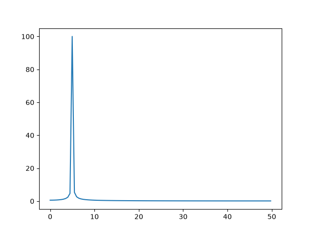

# Upend

Hardware and software for a tremor-stabilizing device, built for UpENDing Parkinson's, a nonprofit that uses climbing as therapy for people with Parkinson's disease. The goal: help participants whose tremors make it hard to photograph or film themselves climbing.

## How it works (current stage)
ESP32 microcontroller → USB serial → Python receiver → FFT → live frequency plot

- `firmware/serial_counter/serial_counter.ino`: ESP32 sketch that emits a simulated 5 Hz tremor signal at 100 Hz, using non-blocking `millis()` timing
- `receiver.py`: reads samples over serial, keeps a rolling window, runs an FFT with NumPy, and plots the frequency spectrum live. It recovers cleanly when the device disconnects and reconnects.

## Roadmap
- **Stage 0 (done):** ESP32 streams a simulated 5 Hz tremor signal at 100 Hz; Python pipeline detects it
- **Stage 1:** swap in a real IMU (BNO055) for live motion data
- **Stage 2:** single-axis servo stabilization with PID control
- **Stage 3:** two-axis brushless gimbal tuned to tremor frequencies

## Running
1. Flash `firmware/serial_counter` to an ESP32 with the Arduino IDE.
2. Start the receiver:
~~~bash
pip install -r requirements.txt
python receiver.py
~~~
